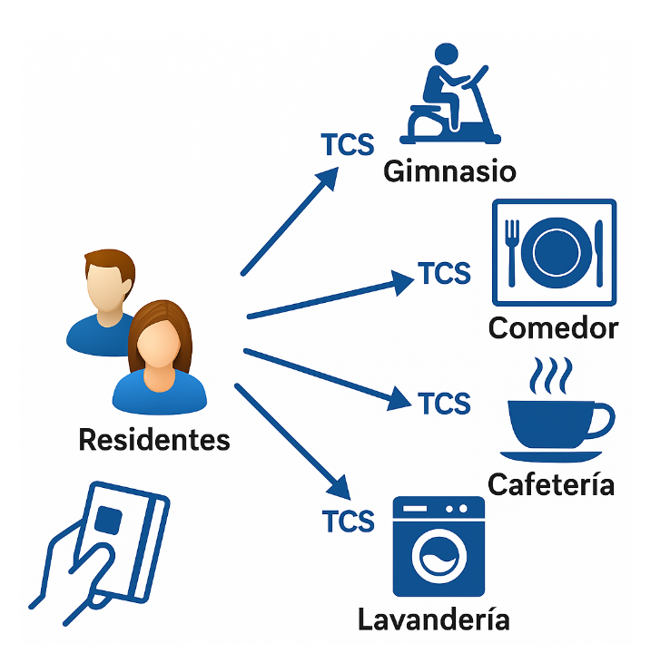
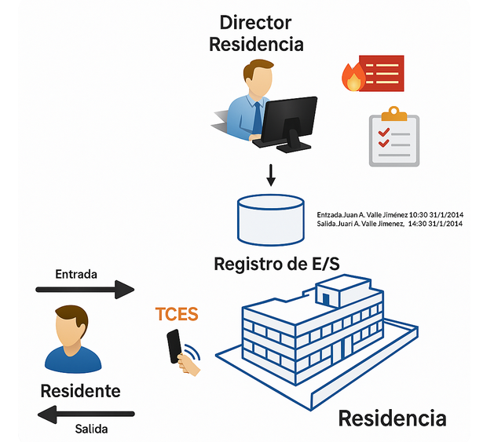

# 0201 Casos de uso de la residencia

**Entornos de Desarrollo · UT02**

## Enunciado

Lee atentamente el siguiente caso práctico.

De esta información deberás **extraer los casos de uso** y los **actores que los desarrollan**, así como los **posibles sistemas externos** que van a interoperar con el nuevo sistema.

1. **Enumera y codifica los actores** en un listado.  
2. **Enumera y codifica los casos de uso** en otro listado.  
3. **Realiza el diagrama de casos de uso** siguiendo los pasos que hemos visto en clase.  
4. **Documenta uno de los casos de uso** que hayas extraído. Elige uno que tenga un curso normal y al menos una alternativa relevante.

La ficha debe incluir: sistema, nombre e identificador del CU, descripción, actores, precondiciones, curso normal numerado, alternativas y postcondiciones. Añade el campo «RF relacionados»: utiliza identificadores del catálogo real si existe; si no puedes inventarlos.

Representa los sistemas externos mediante un rectángulo pequeño con su nombre, situado fuera del límite del sistema y conectado con los casos de uso en los que participan. Se aplica la misma idea de participación que con los actores humanos.

---

## Caso de estudio

Se desea implantar un **sistema de control** que permita a los residentes de un Colegio Mayor el acceso mediante una tarjeta **RFID (Radio Frequency Identification)** a una serie de servicios que se ofrecen en la residencia.

El primer objetivo del sistema es **controlar el acceso al recinto de la residencia**.  
El segundo objetivo es **controlar el uso de determinados servicios** en distintas estancias, como el comedor, la cafetería o el gimnasio.

Cada residente contrata a su llegada, o posteriormente, distintos tipos de servicios. La tarjeta RFID que recibe al formalizar su ingreso permite identificarlo. La aplicación guarda los servicios contratados y consulta esos permisos al leer la tarjeta (ver Figura 1).  
Así, cada residente podrá elegir si contratar o no el servicio de gimnasio, el de pensión completa o solo el régimen de desayuno.  

Esta contratación la hará efectiva el **departamento económico** a través del sistema, **no el residente directamente**. Por defecto, la contratación será para todo el curso, aunque el estudiante puede solicitar la contratación por trimestres.  
El residente deberá poder **consultar sus servicios contratados** a través del sistema.

Cuando el residente acceda a una estancia que ofrece algún servicio, deberá pasar antes por lo que se denomina **Terminal de Control de Servicio (TCS)**. En cada TCS, el residente pasará su tarjeta sobre un lector RFID del sistema, y los **conserjes de la residencia** podrán ver en un monitor asociado si el residente tiene o no acceso al servicio.  
La aplicación gobierna los TCS y TCES, recibe las lecturas de sus lectores RFID y muestra las respuestas en sus monitores. Los terminales no tienen una gestión ni una lógica de permisos independientes de la aplicación. Los lectores de cada servicio permanecen activos durante su horario de uso.

> **Figura 1**. Acceso de residentes a diferentes servicios mediante TCS.

La figura ilustra posibles servicios. En esta tarea se exige modelar los servicios descritos en el texto.
---

Otra funcionalidad que el sistema debe ofrecer es la de **registrar las entradas y salidas** de los residentes a la residencia (ver Figura 2). Esto se realizará mediante los **Terminales de Control de Entrada y Salida (TCES)**.  

El TCES y la información que proporciona permitirán que el **director** pueda tomar decisiones posteriormente, por ejemplo, sobre evacuaciones en caso de incendio o para determinar el grado de permanencia de los residentes.  

Para ello, el sistema permitirá al director ver el **estado de ocupación** de la residencia en tiempo real y generar **informes de permanencia** por meses, con datos que identifiquen a los residentes presentes en la residencia.

> **Figura 2**. Registro de entrada/salida al recinto de la residencia mediante TCES.

---

La **administración y gestión de las tarjetas** se realizan en el **departamento económico**, asignado una tarjeta a un residente al contratar, activando los permisos de los servicios seleccionados en la aplicación, asociados al residente y a su tarjeta o desactivando una tarjeta si fuera necesario. También debe generar **informes sobre la contratación** de los distintos servicios.

El sistema, al manejar información contable sobre los servicios contratados, deberá **emitir mensualmente y de forma automática** (aunque se podrá cancelar esta emisión por el departamento económico) una **remesa de cobros** con cargo a la cuenta de cada residente.  

Para esta emisión, el sistema se comunicará **vía protocolo HTTPS** con un **sistema de emisión de cobros de una entidad bancaria** mediante un **API REST**.  
El banco gestiona un servicio independiente con el que la aplicación intercambia la remesa. La emisión comienza automáticamente según la periodicidad indicada; el departamento económico puede cancelarla, pero no tiene que iniciarla cada mes.

En cuanto a la seguridad, el sistema deberá ofrecer garantías en el tratamiento de la información.  
De forma **semanal**, y **sin intervención de ningún operador**, deberá **copiar la base de datos de producción** a otra máquina de respaldo denominada **base de datos SCR**.  
Esta máquina ya existe y centraliza todas las copias de seguridad de la residencia.  
El servicio de respaldo SCR recibe las copias y se administra de manera independiente. La copia se inicia automáticamente: no se presupone un operador que la ponga en marcha cada semana.

Los **administrativos de secretaría** consultan los datos de cada residente y generan **informes de ocupación** para gestionar plazas y futuras admisiones, sin acceder al seguimiento de presencia en tiempo real reservado al director.  

Esta información es fundamental para gestionar la ocupación y las futuras admisiones.

El **director** será el único que podrá ver el estado de ocupación de la residencia en tiempo real. Además, podrá colaborar con los conserjes y el personal de secretaría realizando sus funciones si fuera necesario. Esta posibilidad no incluye las funciones del departamento económico.

---

El sistema deberá incorporar una **funcionalidad de notificación**, que permita a los **conserjes** enviar mensajes al móvil de cualquier residente.  
La aplicación enviará las notificaciones a través de un **servicio externo de notificaciones móviles**, que se encarga de hacerlas llegar a los dispositivos. No se pide programar ni configurar ese servicio.  

Los conserjes también podrán solicitar **informes de ocupación anónimos**, es decir, sin incluir datos personales de los residentes.

---

## Entrega

Entrega en Aula Virtual **un único PDF de un máximo de 4 páginas en total**, incluidas portada si la hubiera, diagramas, fuentes y anexos. No es necesario añadir portada. Identifica tu trabajo al principio.

El PDF debe contener:

- Listado y codificación de actores.
- Listado y codificación de casos de uso.
- Diagrama de casos de uso legible en una sola página.
- Ficha completa de un caso de uso.
- Fuentes y declaración de uso de IA.

Sintetiza las explicaciones para respetar el límite sin reducir la legibilidad de los diagramas. Conserva los editables; la entrega solicitada es el PDF.

## Herramientas, fuentes y autoría

Puedes utilizar la herramienta de diagramación que prefieras. Conserva los archivos editables para poder revisar y explicar tu modelo.

Incluye al final las fuentes consultadas y una declaración breve del uso de IA: herramienta, para qué la utilizaste y qué revisaste o modificaste. Si no la utilizaste, indícalo. Debes poder explicar tus decisiones y los elementos de tus diagramas. El profesor podrá pedirte esa explicación sin ayuda de IA.

## Rúbrica

| Calificación | Criterio |
|---|---|
| 0 | **No entregado.** |
| 3 | **La mayoría de las respuestas son incorrectas.** La tarea presenta errores importantes que muestran una comprensión insuficiente de los contenidos o dificultades para aplicar los procedimientos trabajados. |
| 6 | **La mayoría de las respuestas son correctas.** Se demuestra una comprensión general de los contenidos y una aplicación adecuada de los procedimientos, aunque quedan errores u omisiones por corregir. |
| 9 | **Todo correcto.** La tarea responde de forma completa y correcta a lo solicitado, con explicaciones claras y procedimientos bien aplicados. |
| 10 | **Todo correcto y con una aportación extra.** Además de resolver correctamente la tarea, incorporas una aportación propia y pertinente que enriquece el trabajo, como un ejemplo, una comprobación adicional o una reflexión razonada. |

La aportación adicional debe caber en la extensión máxima. Usar varias herramientas o añadir complejidad sin justificarla no constituye por sí solo una aportación extra.
