- [Elaboración de diagramas](#elaboración-de-diagramas)
  - [Recorrido de aprendizaje](#recorrido-de-aprendizaje)
  - [Introducción UML: Diagramas](#introducción-uml-diagramas)
  - [Diagramas de casos de uso](#diagramas-de-casos-de-uso)
  - [Diagramas de secuencia](#diagramas-de-secuencia)
  - [Diagramas de comunicación](#diagramas-de-comunicación)
  - [Diagrama de actividad +](#diagrama-de-actividad-)
  - [Diagrama de estados +](#diagrama-de-estados-)
      - [Referencias](#referencias)

# Elaboración de diagramas

## Recorrido de aprendizaje

El recorrido combina explicaciones, prácticas, revisiones y una prueba individual. Los enunciados y las entregas se abren desde Aula Virtual.

| AEA | Actividad | Recursos |
|---|---|---|
| I | UML como lenguaje de comunicación | [Introducción](#introducción-uml-diagramas) |
| II | Investigación y puesta en común |  |
| III | Casos de uso: conceptos y ejemplos | [Casos de uso](#diagramas-de-casos-de-uso) |
| IV | Prueba de herramientas | [Guía de PlantUML](./PlantUML.md) |
| V | Documentación de casos de uso | [Fichas de CU](#documentación-de-un-caso-de-uso) |
| VI | 0201 Casos de uso de la residencia |  |
| VII | Diagramas de secuencia | [Secuencia](#diagramas-de-secuencia) |
| VIII | 0202 Secuencias de biblioteca |  |
| IX | Diagramas de comunicación | [Comunicación](#diagramas-de-comunicación) |
| X | Comparación de secuencia y comunicación | [Secuencia](#diagramas-de-secuencia) y [comunicación](#diagramas-de-comunicación) |
| XI | Diagramas de actividades | [Actividades](./ED0204actividad.md) |
| XII | Práctica de actividades |  |
| XIII | Diagramas de estados | [Estados](./ED0203estado.md) |
| XIV | 0203 Estados y actividades |  |
| XV | Panorama de diagramas y repaso | [Apuntes de la unidad](#introducción-uml-diagramas) |
| XVI | Integración y revisión de ejemplos |  |
| XVII | Prueba individual |  |

<!-- Presentaciones de la UT: destino pendiente de completar por el docente. -->

## Introducción UML: Diagramas

Los diagramas que vamos a estudiar son:

- Diagramas de casos de uso
- Diagramas de secuencia
- Diagramas de comunicación
- Diagramas de estados
- Diagramas de actividades

Para crear estos diagramas a partir de texto y visualizarlos en VS Code, consulta la [guía de PlantUML](./PlantUML.md), con sintaxis básica y ejemplos editables.

## Diagramas de casos de uso

**Diagrama de casos de uso**
Un diagrama de casos de uso representa, de forma general, qué puede hacer un usuario u otro sistema con la aplicación. Ayuda a identificar los servicios principales que ofrece el sistema y quién interactúa con ellos, sin entrar todavía en cómo se programan internamente.

* ***ELEMENTOS***

- **Sistema** (recuadro con el nombre)
- **Actores**: roles humanos, representados habitualmente con un monigote, o sistemas externos que participan en la interacción.
- **Casos** de **uso** (óvalos)
- **Asociaciones** entre Caso de uso y actores (segmentos)
- **Relaciones**:
  - **inclusión**: ejecución obligatoria de casos de uso
    
    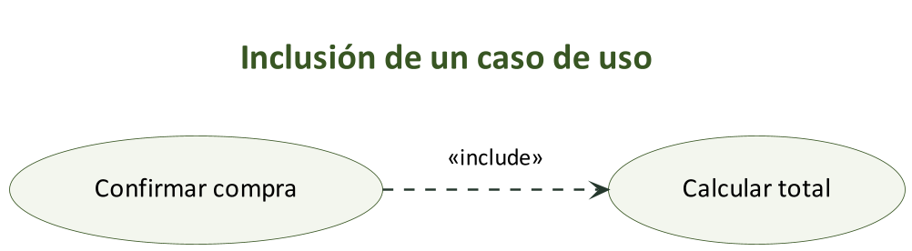

  - **extensión**: variaciones opcionales de casos de uso
    
    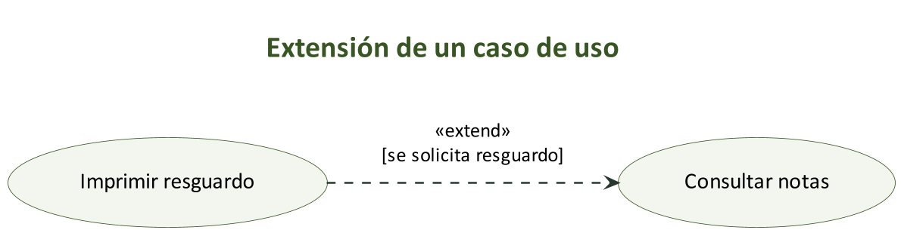

  - **generalización**: representa una especialización entre actores o entre casos de uso. El elemento especializado hereda las características del general. Se dibuja con una línea continua y un triángulo vacío dirigido hacia el elemento general.
    
    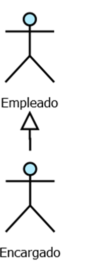
  

* Ejemplo 1

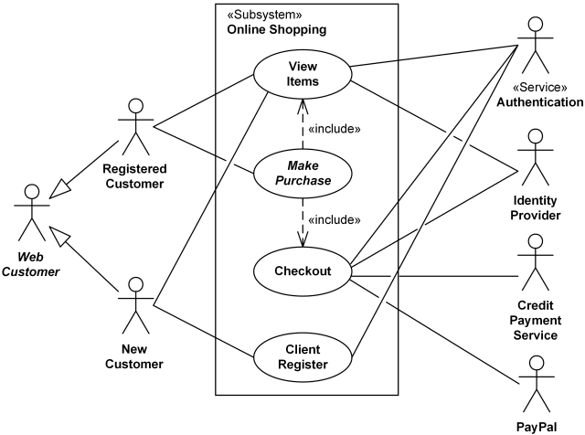

* Ejemplo 2

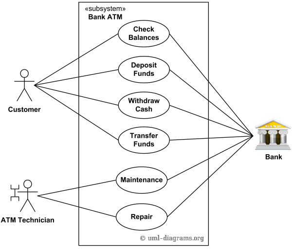

### Sistemas externos como actores

Un servicio informático externo puede participar en un caso de uso. Lo dibujamos con un **rectángulo pequeño rotulado «actor» y su nombre, fuera del recuadro del sistema**. La asociación con el caso de uso es una línea sin punta de flecha. El rectángulo identifica aquí un actor; no estamos dibujando una clase ni un nodo de objeto de un diagrama de actividades.

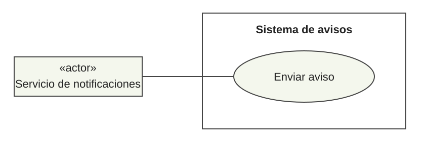

La participación no implica que ese actor inicie la operación. Por ejemplo, una aplicación puede ejecutar automáticamente un proceso programado e intercambiar datos con un servicio externo. No se inventa un operador humano que lo active si el caso indica que es automático.

### Ejemplo 3: Instituto

El estudiante consulta las notas y el profesor las modifica. Imprimir un resguardo extiende cualquiera de esos casos de uso cuando se solicita la impresión.

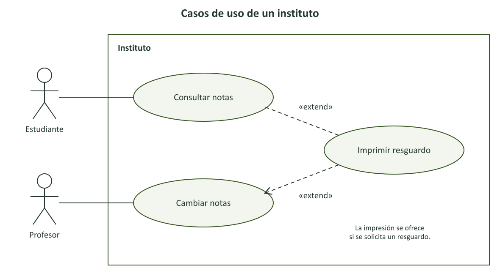

### Relación entre RF y casos de uso

Un **requisito funcional (RF)** expresa una capacidad concreta que la aplicación proporciona a un actor. Debe estar escrito de forma clara y permitir comprobar si se cumple. En clase conservamos la pauta de redactarlo con el actor como sujeto, por ejemplo: «El personal podrá confirmar una reserva si el horario está disponible».

Un **caso de uso (CU)** describe la interacción que permite a un actor alcanzar un objetivo, por ejemplo, crear una reserva. Su curso puede alternar acciones del actor y respuestas del sistema: el personal solicita la reserva, el sistema comprueba el horario y el personal confirma.

Al describir esa interacción relacionamos los RF que intervienen y podemos descubrir requisitos incompletos o ambiguos. Un CU puede relacionar varios RF y un RF puede participar en varios CU. No hay una jerarquía universal de CU como «padres» de todos los requisitos, ni cada paso del curso tiene que convertirse automáticamente en un RF.

### Documentación de un caso de uso

El diagrama ofrece una visión general. Para describir lo que ocurre en cada caso de uso utilizamos una ficha con estos campos:

| Campo | Qué recoge |
|---|---|
| Nombre | El objetivo del actor, normalmente expresado con un verbo en infinitivo. |
| ID | El identificador del caso de uso. |
| RF relacionados | Los identificadores de los requisitos funcionales del proyecto que intervienen en este CU. |
| Descripción | Una explicación breve de su finalidad. |
| Actores | Los roles que participan. |
| Precondiciones | Lo que debe cumplirse antes de comenzar. |
| Curso normal | Los pasos que conducen al resultado esperado, alternando actor y sistema cuando corresponda. |
| Alternativas | Otros caminos posibles, incluidos errores y excepciones. |
| Postcondiciones | Lo que queda establecido al finalizar. |

Los identificadores de «RF relacionados» deben corresponder al catálogo real de requisitos del proyecto. Describir el flujo ayuda a comprobar si cubre los compromisos de esos RF.

## Diagramas de secuencia

**Diagrama de secuencia**
Un diagrama de secuencia representa cómo interactúan distintos objetos o elementos del sistema a lo largo del tiempo. Permite ver el orden en que se envían los mensajes entre ellos para realizar una operación concreta, ayudando a comprender la colaboración entre partes del sistema sin centrarse todavía en el código interno.

* Permiten añadir la variable TIEMPO (dimensión y)
* Muestran el orden de las interacciones. La distancia vertical no representa por sí sola una duración exacta.
* Detallan escenarios de los casos de uso. Un caso de uso puede tener varios escenarios, representados mediante distintos diagramas de secuencia.
* ELEMENTOS: (dimensión x)
* OBJETOS y ACTORES: originan la secuencia de mensajes
* MENSAJES: representan la interacción entre dos objetos
* Un objeto puede interaccionar consigo mismo

### Lectura del tiempo y los mensajes

El diagrama permite seguir el orden de los sucesos. La separación entre dos mensajes no indica una cantidad fija de segundos, salvo que el modelo incluya una restricción temporal explícita.

- **Llamada síncrona:** el emisor espera a que termine la operación llamada. Se representa con línea continua y punta triangular rellena.
- **Mensaje asíncrono:** el emisor puede continuar sin esperar a que el receptor termine. Se representa con línea continua y punta abierta.
- **Respuesta:** puede mostrar el resultado de una llamada mediante una línea discontinua y punta abierta.
- **Concurrencia:** hay comportamientos cuya ejecución puede solaparse. Puede representarse mediante un fragmento `par`. Un mensaje asíncrono no demuestra por sí solo que haya ejecución simultánea.

Dos flechas a la misma altura no constituyen por sí solas un error: hay que interpretar el orden y las restricciones del modelo.

* ***ELEMENTOS***

- **Actores** 
- **Objetos**
 
 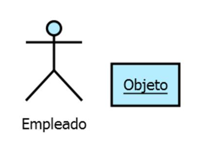
- **Línea** de vida
- **Mensajes**

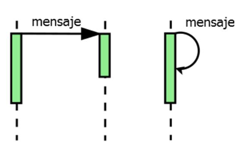

- **alt**: se ejecuta un bloque u otro dependiendo de una condición

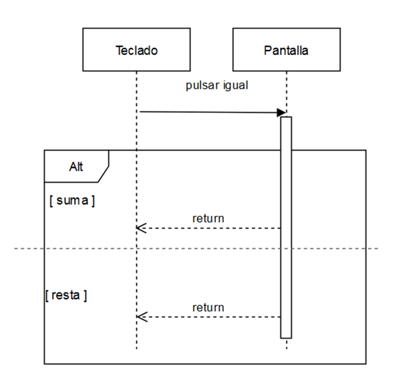

- **loop**: se repite una acción varias veces 

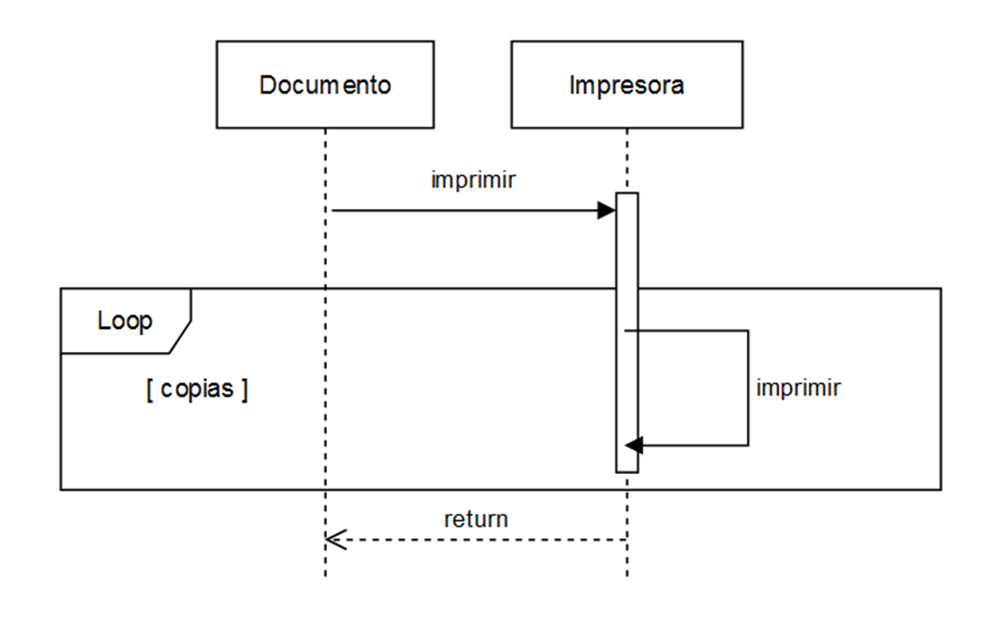

* Ejemplo 1

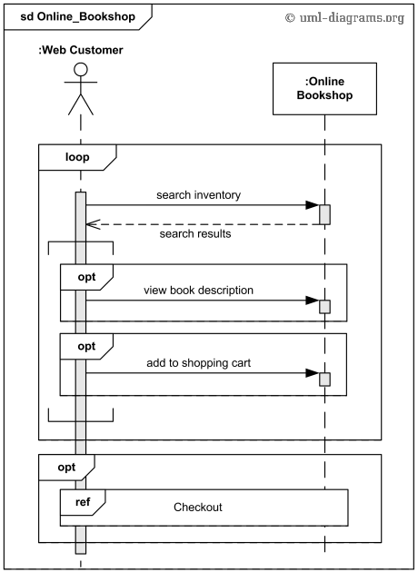

* Ejemplo 2

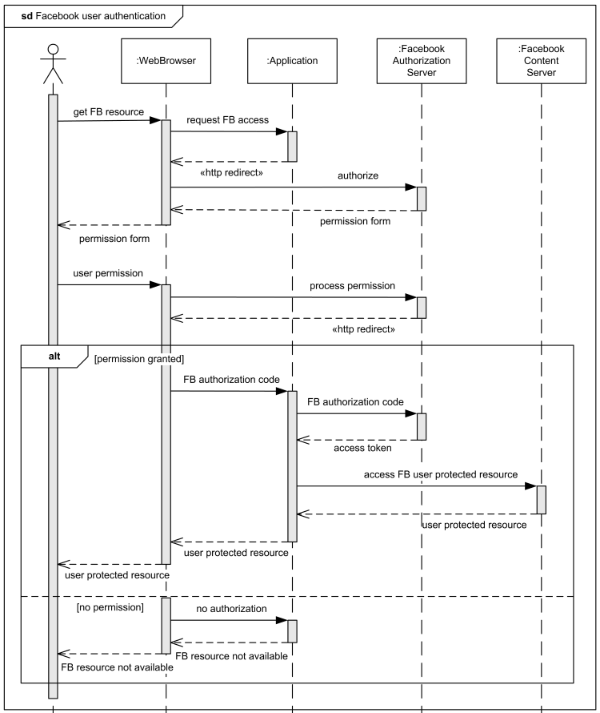

## Diagramas de comunicación

Un **diagrama de comunicación** representa cómo colaboran los participantes de un sistema mediante el intercambio de mensajes. Destaca quién se comunica con quién para realizar una operación.

Sus elementos principales son:

- **Participantes:** actores u objetos que intervienen en la interacción.
- **Enlaces:** conexiones entre participantes por las que pueden intercambiar mensajes.
- **Mensajes:** indican la operación, su dirección y su orden mediante números como `1`, `1.1` y `1.2`.

### Ejemplo de comunicación: confirmar un pedido

En este escenario hay existencias disponibles. La tienda coordina la consulta al inventario y el registro del pedido:

1. `1: confirmarPedido()` — El cliente solicita la confirmación a la tienda.
2. `1.1: comprobarDisponibilidad()` — Durante la atención de esa solicitud, la tienda consulta al inventario.
3. `1.2: registrarPedido()` — Tras la comprobación, la tienda solicita el registro al gestor de pedidos.

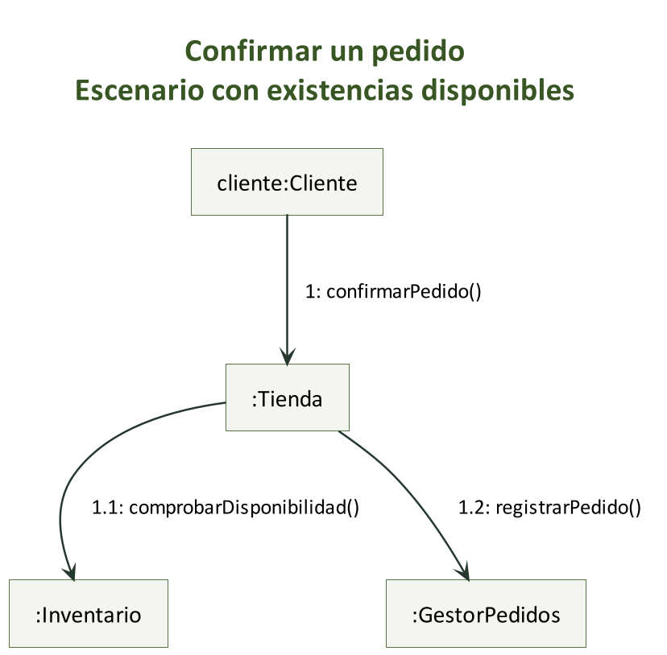

Los mensajes `1.1` y `1.2` se producen durante la atención del mensaje `1`. La numeración indica su orden y anidamiento. La colocación de las cajas no es una escala temporal.

El diagrama de secuencia permite seguir los mensajes en orden vertical. El de comunicación destaca las conexiones entre participantes y expresa el orden mediante la numeración.

[Fuente editable del ejemplo en PlantUML](diagramas/comunicacion_pedido_rev01.puml)

## Diagrama de actividad [+](./ED0204actividad.md)

**Diagrama de actividades**
Un diagrama de actividades representa el flujo de pasos que se siguen para realizar una tarea o proceso. Permite ver el orden de las acciones, las decisiones que pueden aparecer y los distintos caminos posibles, de forma parecida a un diagrama de flujo, pero dentro del contexto del modelado UML.

* ***ELEMENTOS***

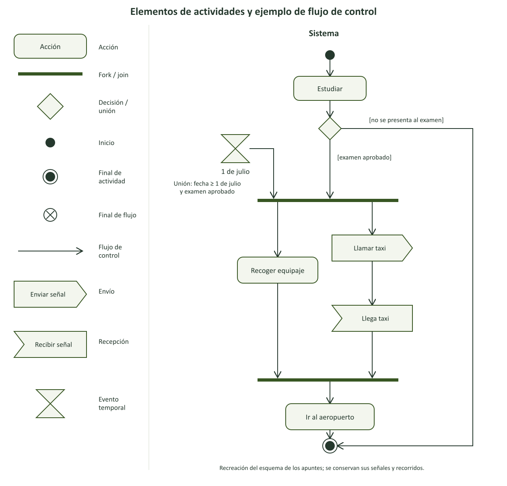

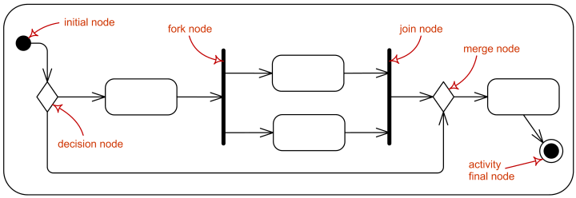

* Ejemplo 1

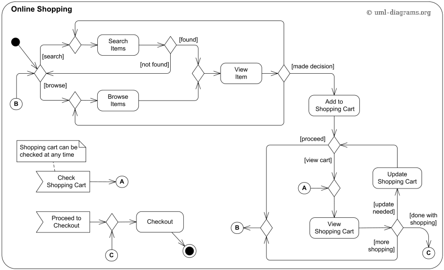

* Ejemplo 2

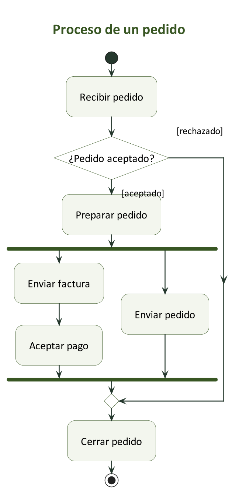

* Ejemplo 3

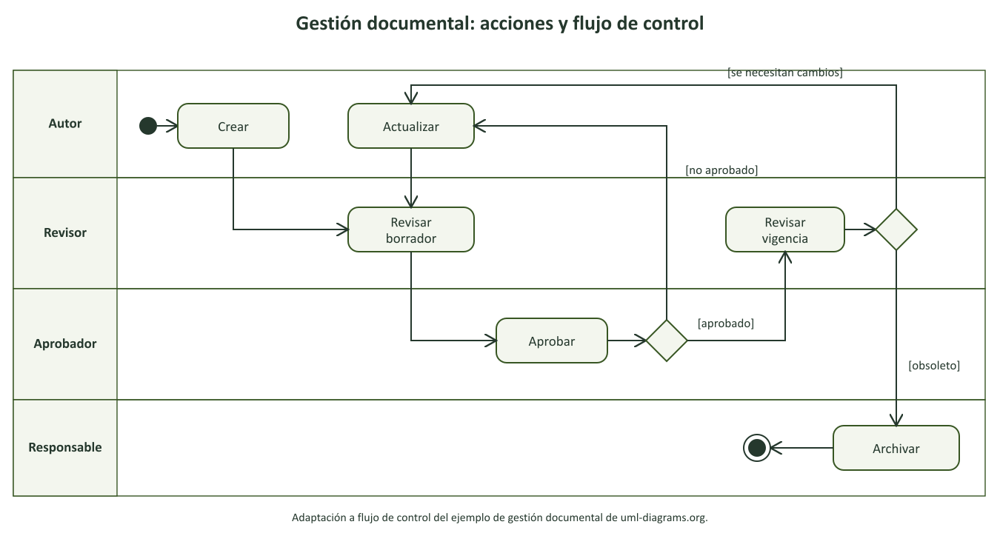

## Diagrama de estados [+](./ED0203estado.md)

**Diagrama de estados**
Un diagrama de estados muestra los distintos estados por los que puede pasar un objeto o elemento del sistema a lo largo del tiempo. Resulta útil cuando queremos entender cómo cambia su situación según los eventos que ocurren, por ejemplo, un pedido que pasa de “pendiente” a “enviado” o “cancelado”.

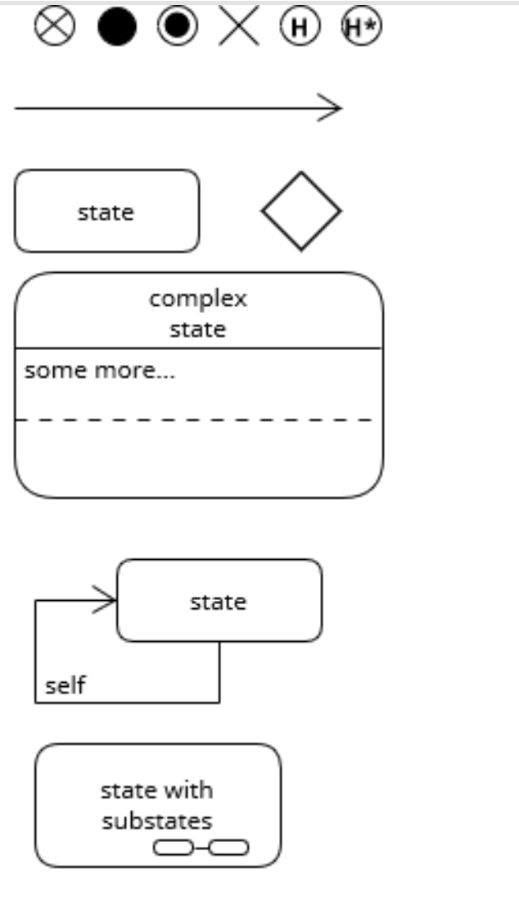

* Ejemplo 1

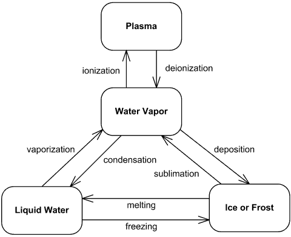

#### Referencias

- [Diagramas UML de ejemplo](https://uml-diagrams.org)
- [Ejemplos](https://www.uml-diagrams.org/index-examples.html)
- [OMG.org, donde bajar las especificaciones de UML](https://www.omg.org/spec/UML/)
- [UML.org](http://uml.org)

