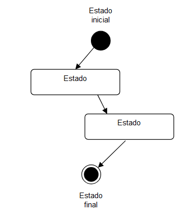
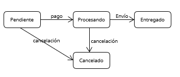
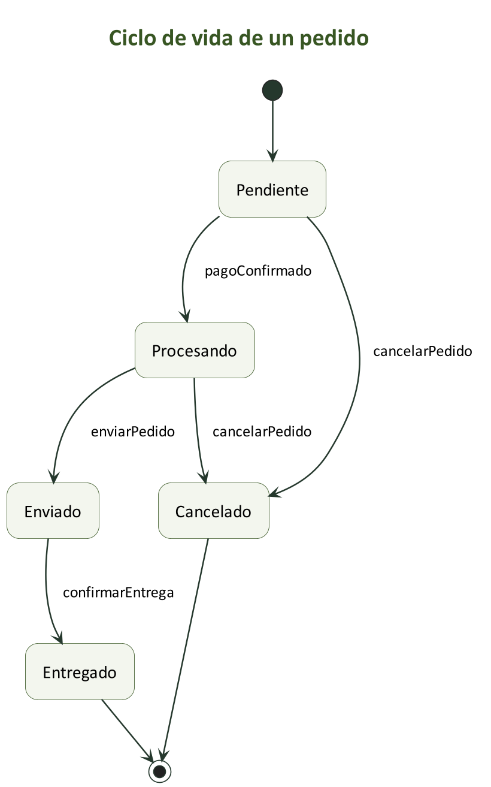

[Volver al índice principal](./ED0200.md)

# Diagramas de Estado en UML

## Introducción
Los diagramas de estado en UML (Lenguaje de Modelado Unificado) son herramientas visuales que permiten modelar el comportamiento dinámico de un sistema, particularmente cómo un objeto cambia de estado en respuesta a diferentes eventos. Estos diagramas son especialmente útiles en sistemas donde los objetos tienen ciclos de vida complejos y dependen de estados específicos para funcionar correctamente.

A través de los diagramas de estado, se puede comprender mejor el flujo y las transformaciones que ocurren en los objetos del sistema. Esto hace que el modelado de sistemas sea más claro y detallado, permitiendo anticipar y manejar mejor los posibles escenarios en el diseño y desarrollo de software.

## Utilidad de los Diagramas de Estado
Los diagramas de estado son valiosos en el diseño de sistemas orientados a objetos, ya que ayudan a modelar el comportamiento de un objeto a lo largo de su ciclo de vida. Son útiles en diversas fases del desarrollo de software:

- **Análisis de Requisitos**: Permiten visualizar cómo el sistema debe responder ante distintos eventos, proporcionando claridad sobre el comportamiento esperado de los objetos.
- **Diseño de Sistemas**: Ayudan a identificar y diseñar correctamente las transiciones y comportamientos de los objetos. Esto garantiza que el sistema funcione adecuadamente bajo diferentes condiciones.
- **Pruebas y Depuración**: Al mostrar todos los posibles estados y transiciones de un objeto, es más fácil planificar pruebas exhaustivas y localizar errores en el comportamiento del sistema.

Los diagramas de estado también facilitan la comunicación entre los miembros del equipo, al ofrecer un lenguaje visual común que representa el comportamiento del sistema de forma intuitiva.

## Elementos de los Diagramas de Estado
1. **Estados**: Representan las distintas etapas o condiciones de un objeto en un momento determinado. Cada estado puede tener subestados y acciones asociadas, que describen las actividades que el objeto realiza mientras se encuentra en dicho estado. *Se representa con un rectángulo de esquinas redondeadas*
2. **Transiciones**: Indican cómo un objeto pasa de un estado a otro. Se representan con flechas. Su etiqueta puede tener la forma `evento [condición] / efecto`; se omiten los componentes que no correspondan.
   - **Evento**: El suceso que puede desencadenar la transición, como recibir una petición o vencer un temporizador.
   - **Condición o guarda**: La expresión booleana entre corchetes que debe ser verdadera para que pueda tomarse esa transición.
   - **Efecto**: La operación que se ejecuta al tomar la transición, escrita después de `/`.
3. **Estados Inicial y Final**: El inicial indica el punto de partida y se representa con un círculo negro. El final indica la finalización y se representa con un círculo negro rodeado por otro círculo.

**Precisión de vocabulario:** mantenemos «estado inicial» como denominación didáctica; técnicamente, ese símbolo es un *pseudoestado inicial*, no un estado ordinario del objeto.

Las acciones de entrada (`entry`) y salida (`exit`) pertenecen al estado y se escriben dentro de él. Una actividad `do` se ejecuta mientras el estado está activo. Se distinguen del efecto escrito en la etiqueta de una transición.

## Ejemplo de uso de etiquetas para Evento y Acción

          ┌───────────────────────┐
          │ EsperandoCredenciales │
          └──────────┬────────────┘
                     │
      **ingresarCredenciales** / *verificarCredenciales*
                     │
                     │
           ┌─────────▼────────┐
           │    Verificando   │
           └─────────┬────────┘
                     │
        **credencialesCorrectas** / *mostrarBienvenida*
                     │
                     │
       ┌─────────────▼─────────────┐
       │      AccesoPermitido      │
       └───────────────────────────┘

## Ejemplos de Diagramas de Estado

### Ejemplo Sencillo
Consideremos un ciclo de vida simplificado de un pedido en un sistema de compras en línea. Este objeto "Pedido" podría tener los siguientes estados y transiciones:

- **Estados**:
  - *Pendiente*: El pedido ha sido creado pero no confirmado.
  - *Procesando*: El pedido ha sido confirmado y se está preparando para su envío.
  - *Entregado*: El pedido ha sido recibido por el cliente.
  - *Cancelado*: El pedido se ha anulado; en este ejemplo se alcanza desde *Pendiente* o *Procesando* mediante una petición de cancelación.

- **Transiciones y Eventos**:
  - De *Pendiente* a *Procesando*: Cuando el pago es confirmado, el pedido pasa a "Procesando".
  - De *Procesando* a *Entregado*: Cuando el cliente recibe el pedido, se registra como "Entregado".
  - Desde *Pendiente* o *Procesando*, una orden puede pasar a *Cancelado* si el cliente decide cancelar antes de que el pedido sea "Entregado".

### Ejemplo ampliado: envío y entrega del pedido

Conservamos el esquema sencillo anterior y añadimos este modelo para distinguir **enviar** el pedido de **entregarlo** al cliente:

- **Enviado**: el pedido ya ha salido, pero todavía no consta su recepción.
- De *Procesando* a *Enviado*: `enviarPedido`.
- De *Enviado* a *Entregado*: `confirmarEntrega`.
- La cancelación se admite desde *Pendiente* o *Procesando*, antes del envío, en este ejemplo.

[Fuente editable del pedido en PlantUML](diagramas/pedido_estados_rev02.puml)

[Volver al índice principal](./ED0200.md)

