# PlantUML: crear diagramas con texto y visualizarlos en VS Code

PlantUML convierte una descripción de texto en un diagrama. Puedes escribirla tú o pedir un primer borrador a ChatGPT y después revisarlo. El archivo editable suele tener extensión `.puml`; la imagen SVG o PNG es el resultado, no sustituye al original.

UML es el lenguaje de modelado; PlantUML es una herramienta para representarlo. Que el código se dibuje sin errores no garantiza que el modelo sea correcto. [Introducción oficial a PlantUML](https://plantuml.com/starting).

- [Visualizar en VS Code](#visualizar-en-vs-code)
- [Sintaxis básica](#sintaxis-básica)
- [Cinco tipos de diagramas](#cinco-tipos-de-diagramas)
- [Exportar y conservar el editable](#exportar-y-conservar-el-editable)
- [Pedir un borrador a ChatGPT](#pedir-un-borrador-a-chatgpt)
- [Si algo falla](#si-algo-falla)

## Visualizar en VS Code

### Preparar las herramientas

1. En VS Code, abre **Extensiones** con **Ctrl + Shift + X**.
2. Busca e instala **PlantUML**, de **jebbs**, identificador `jebbs.plantuml`. Comprueba el autor para no confundirla con otras extensiones.
3. Para trabajar en local necesitas Java. Abre una terminal y comprueba:

```text
java -version
```

PlantUML recomienda Java 11 o posterior. Si no lo tienes, puedes instalar un JDK compatible desde [Eclipse Temurin](https://adoptium.net/temurin/releases/). Después abre de nuevo VS Code y su terminal.

En Windows, la extensión incorpora PlantUML y Graphviz: prueba primero sin descargar JAR adicionales. En Linux o macOS puede ser necesario instalar [Graphviz](https://graphviz.org/download/) con las herramientas del sistema. Graphviz ayuda a colocar elementos en algunos tipos de diagramas; no es necesario para todos. [Requisitos de PlantUML](https://plantuml.com/starting), [Graphviz y PlantUML](https://plantuml.com/graphviz-dot).

### Elegir el renderizado local

Abre la configuración de VS Code, busca `plantuml.render` y selecciona **Local**. También puedes incorporar esta propiedad a la configuración JSON, respetando las que ya existan:

```json
{
  "plantuml.render": "Local"
}
```

No necesitas configurar `plantuml.jar` para usar el que incluye la extensión. [Configuración oficial de la extensión](https://marketplace.visualstudio.com/items?itemName=jebbs.plantuml).

El modo **PlantUMLServer** es otra posibilidad, pero envía el texto al servidor configurado. No utilices un servidor público para diagramas reservados, datos personales, soluciones o exámenes. Un servidor propio también exige revisar quién puede acceder a él. En esta guía usamos renderizado local.

### Abrir la primera vista previa

1. Crea un archivo llamado `inicio.puml` y pega el ejemplo siguiente.
2. Guárdalo como texto UTF-8.
3. Con el cursor dentro del diagrama, pulsa **Alt + D** en Windows/Linux.
4. Alternativamente, abre **Ctrl + Shift + P** y ejecuta **PlantUML: Preview Current Diagram**. El nombre puede aparecer traducido.

Al modificar el texto se actualiza la vista previa. [Vista previa y exportación de la extensión](https://github.com/qjebbs/vscode-plantuml).

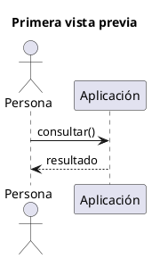

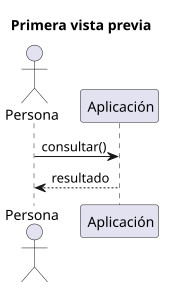

[Archivo editable .puml](plantuml/01_inicio.puml)

## Sintaxis básica

En los ejemplos de esta guía:

- `@startuml` y `@enduml` delimitan un diagrama completo.
- `title` añade su título.
- Una línea que comienza con `'` es un comentario y no aparece en la imagen.
- Las comillas permiten escribir nombres con espacios.
- `as` permite utilizar un identificador corto: `"Aplicación" as App`.
- La sangría ayuda a leer el texto; no sustituye los cierres `end`, `endif` o `}` que requiera cada estructura.

Cada tipo de diagrama tiene su propia sintaxis: una flecha de secuencia no se interpreta igual que una transición de estado. [Comandos comunes](https://plantuml.com/commons).

## Cinco tipos de diagramas

Los ejemplos son independientes. Copia **un bloque completo** en su propio archivo `.puml`, sin las líneas de tres acentos graves que delimitan el código en esta página.

### Casos de uso: servicios y actores

Representan qué ofrece el sistema y quién interactúa con él. `actor` declara un actor, `usecase` un caso de uso y `rectangle` ayuda a delimitar el sistema. Las líneas asocian al actor con los servicios; no expresan el orden de ejecución. [Sintaxis de casos de uso](https://plantuml.com/use-case-diagram).

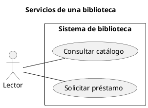

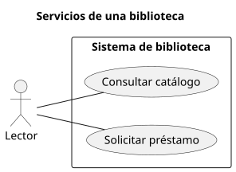

[Archivo editable .puml](plantuml/02_casos_uso.puml)

### Secuencia: mensajes entre participantes

El tiempo avanza de arriba abajo. `->` representa un mensaje y `-->` se utiliza aquí para la respuesta. `autonumber` numera los mensajes; `alt`, `else` y `end` separan alternativas. [Sintaxis de secuencia](https://plantuml.com/sequence-diagram).

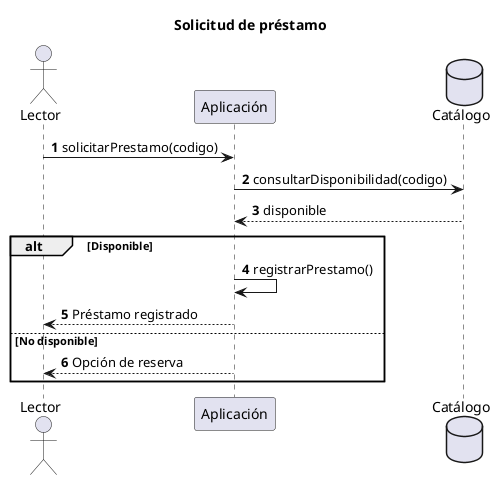

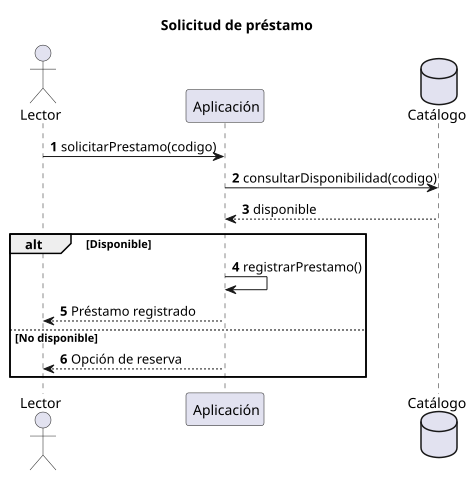

[Archivo editable .puml](plantuml/03_secuencia.puml)

### Actividades: acciones y decisiones

Usa `start` y `stop` para el inicio y el final. Las acciones se escriben entre `:` y `;`. Una decisión se expresa con `if`, `then`, `else` y `endif`; las etiquetas de las ramas van entre paréntesis. [Sintaxis de actividades](https://plantuml.com/activity-diagram-beta).

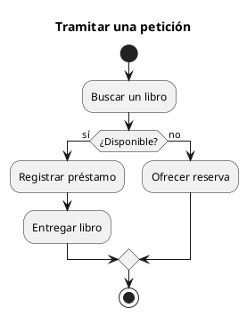

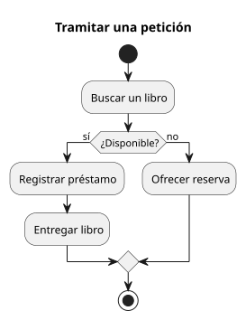

[Archivo editable .puml](plantuml/04_actividades.puml)

Para representar una repetición, PlantUML también admite `while (...) is (...)` con su cierre `endwhile`, o `repeat` con `repeat while (...)`. No confundas una decisión con un bucle: la estructura debe corresponder al proceso que quieres explicar.

### Estados: situación de un objeto y transiciones

`[*]` representa el punto inicial o final según la dirección de la flecha. El texto tras `:` etiqueta el evento que provoca una transición. Un estado describe una situación del objeto, no un mensaje entre participantes. [Sintaxis de estados](https://plantuml.com/state-diagram).

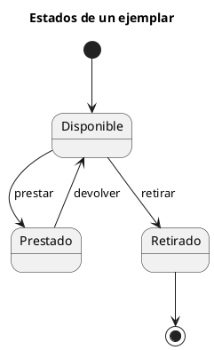

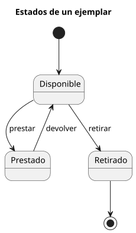

[Archivo editable .puml](plantuml/05_estados.puml)

### Clases: estructura y relaciones

`class` declara una clase y las llaves delimitan atributos y operaciones. En este ejemplo, `-` indica privado y `+` público. `<|--` expresa herencia y `--` una asociación.

Cada préstamo pertenece a un libro; un libro puede tener cero o muchos préstamos en su historial. Las multiplicidades son decisiones del modelo, no valores que PlantUML compruebe por ti. [Sintaxis de clases](https://plantuml.com/class-diagram).

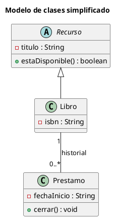

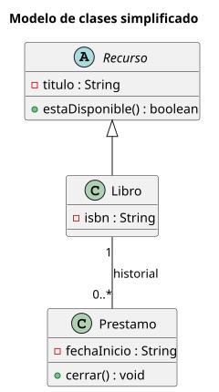

[Archivo editable .puml](plantuml/06_clases.puml)

PlantUML representa el diseño que escribes. Este ejemplo no genera automáticamente la implementación Java ni hace ingeniería inversa de tu proyecto.

## Exportar y conservar el editable

Abre la paleta de comandos y utiliza **PlantUML: Export Current Diagram**. Elige **SVG** para una imagen vectorial o **PNG** cuando necesites ese formato. [Exportación de la extensión](https://marketplace.visualstudio.com/items?itemName=jebbs.plantuml).

Conserva siempre el `.puml` junto a la documentación o código al que se refiere. Si lo incluyes en Git podrás revisar las modificaciones como texto y regenerar la imagen cuando cambie el modelo. No sobrescribas fuentes anteriores con una imagen sin editable.

Un bloque de código `plantuml` en Markdown no garantiza que cualquier visor lo dibuje. Para publicarlo sin depender de extensiones del navegador, puedes exportar e insertar la imagen:

```markdown

```

En esta página se incluyen tanto las imágenes como los archivos editables de los ejemplos.

## Pedir un borrador a ChatGPT

Describe primero qué quieres representar: tipo de diagrama, participantes o clases, acciones, reglas y alternativas. Por ejemplo:

> Escribe un diagrama de secuencia en PlantUML para consultar un catálogo. Incluye una persona, una aplicación y el catálogo, y distingue entre encontrar resultados y no encontrarlos. Devuelve únicamente el código completo entre @startuml y @enduml. No inventes participantes ni requisitos adicionales.

Después revisa el borrador:

1. ¿Se ajusta a la situación descrita o ha añadido supuestos?
2. ¿Es el tipo de diagrama adecuado?
3. ¿Son correctas las relaciones, decisiones y multiplicidades?
4. ¿Puedes explicar qué significa cada elemento?

Si algo no encaja, corrige el texto y vuelve a visualizarlo. Informa del uso de IA cuando corresponda; esta ayuda no autoriza su uso en defensas o exámenes en los que no esté permitida.

Los mismos archivos `.puml` pueden utilizarse en IntelliJ IDEA con un complemento compatible, como [PlantUML Integration / plantuml4idea](https://plugins.jetbrains.com/plugin/7017-plantuml4idea). Cambia el entorno de visualización, no la sintaxis del archivo.

## Si algo falla

- **No aparece la vista previa:** comprueba que el archivo termina en `.puml`, que está activa la extensión y que el cursor está dentro del diagrama.
- **No encuentra Java:** prueba `java -version` en una terminal nueva. Revisa el PATH o configura `plantuml.java` con la ubicación real de su ejecutable.
- **Error relacionado con Graphviz o dot:** consulta la [comprobación oficial de Graphviz](https://plantuml.com/graphviz-dot). Una instalación externa puede comprobarse con `dot -V`; en Windows puede funcionar la copia integrada aunque ese comando no esté en el PATH.
- **Error de sintaxis:** empieza por el ejemplo mínimo; revisa comillas rectas, llaves y cierres. No pegues también las líneas de tres acentos graves.
- **No se entiende el dibujo:** simplifica el modelo y revisa su significado antes de cambiar colores o distribución.

Volver al [índice de ED](../../README.md).
